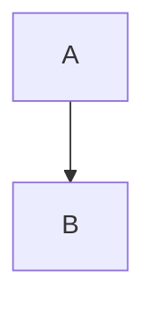

# Hexo Filter Merman

[![npm-image]][npm-url]
[![lic-image]](LICENSE)

Browserless server-side [Mermaid](https://mermaid.js.org/) renderer for Hexo, powered by [Merman](https://github.com/Latias94/merman).

The plugin replaces Mermaid source blocks with inline SVG during `hexo generate`. It does not launch Chromium or ship client-side Mermaid JavaScript.

## Installation

```bash
npm install hexo-filter-merman
hexo clean
```

The following HTML forms are supported:

```html
<pre><code class="mermaid">flowchart TD
  A --> B
</code></pre>

<pre><code class="language-mermaid">flowchart TD
  A --> B
</code></pre>
```

NexT's `` tag emits the first form and works without further changes.

Standard Mermaid fences are supported too:

````markdown

````

To keep Hexo's syntax highlighter from consuming fenced diagrams first, exclude `mermaid` in the site `_config.yml`:

```yaml
highlight:
  line_number: true
  auto_detect: false
  tab_replace: ''
  wrap: true
  exclude_languages:
    - mermaid
```

Sites using Prism should add the same entry under `prismjs.exclude_languages` instead.

## Configuration

Rendering is enabled by default. Merman binding options can be passed through without translation:

```yaml
merman:
  enable: true
  options:
    site_config:
      theme: neutral
      flowchart:
        curve: linear
    svg:
      pipeline: readable
```

The plugin assigns a stable, unique `svg.diagram_id` to every diagram. A configured `diagram_id` is therefore ignored.

See Merman's [`SvgBindingOptions`](https://github.com/Latias94/merman/blob/main/platforms/web/src/index.ts) for the complete options surface.

Merman SVGs contain scoped inline CSS. If a theme derives the page description directly from post HTML, put an explicit `description` in the post front matter to keep SVG styles out of generated metadata.

## License

Released under the MIT License.

[npm-image]: https://img.shields.io/npm/v/hexo-filter-merman?style=for-the-badge
[lic-image]: https://img.shields.io/npm/l/hexo-filter-merman?style=for-the-badge
[npm-url]: https://www.npmjs.com/package/hexo-filter-merman
